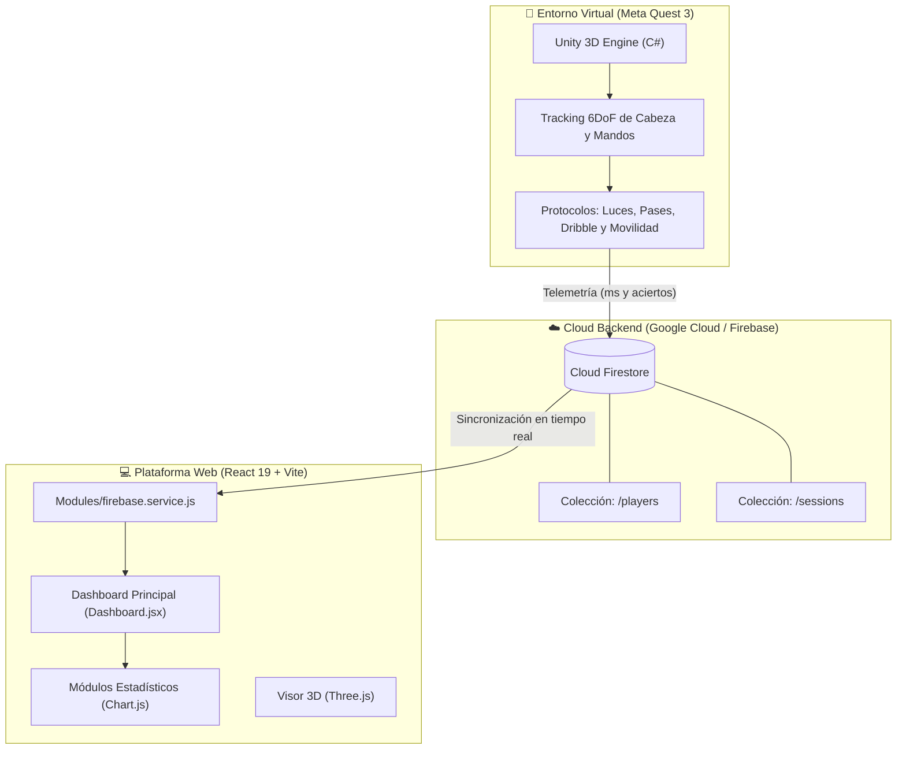
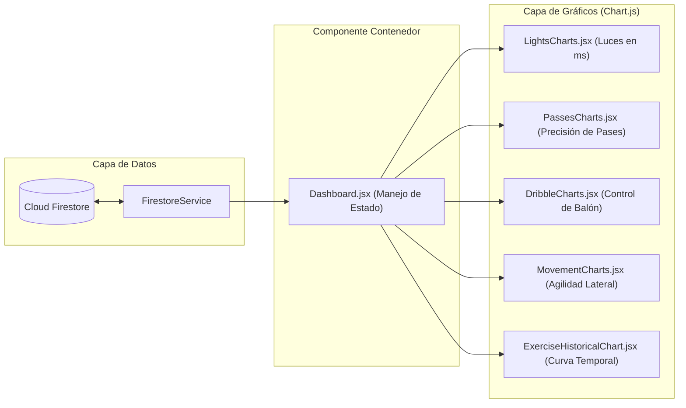

# 🏀 Reaction Hoops — Plataforma Web & Analítica VR

<p align="center">
  
  
  
  
  
  
  
</p>

> **Proyecto de Grado / Trabajo de Tesis**  
> **Universidad de San Buenaventura - Sede Bogotá**  
> **Línea de Investigación**: Evaluación y optimización de la velocidad de reacción y toma de decisiones en deportistas universitarios de baloncesto mediante entornos virtuales inmersivos con **Meta Quest 3**.

---

## 👥 Equipo de Investigación y Desarrollo

| Integrante | Rol Principal | Enlace Profesional |
| :--- | :--- | :--- |
| **Sebastian Villamil** | Desarrollo Web / UX / VR | [serbew.games](https://www.serbew.games) |
| **Katherine Guayazan** | Artista 3D y Diseñadora UI | [Behance](https://www.behance.net/swnoswift) |
| **Miguel Guerrero** | Desarrollador VR & Environment Artist | [Instagram](https://www.instagram.com/miguel_guerrero.01) |
| **Juan Sierra** | Desarrollo Web | [Instagram](https://www.instagram.com/juan_diego2804) |

---

## 🎯 1. Planteamiento de la Tesis

En el baloncesto competitivo, la capacidad de procesar estímulos visuales y reaccionar en milésimas de segundo define la efectividad motriz. Los métodos analógicos tradicionales carecen de estandarización reproducible y dificultan el registro milimétrico de datos.

**Reaction Hoops** integra una experiencia inmersiva con visores **Meta Quest 3** y un **Dashboard Web de Telemetría** para:
- Estandarizar pruebas perceptivo-motrices bajo condiciones de laboratorio controladas.
- Capturar tiempos de reacción en milisegundos y porcentajes de precisión.
- Proporcionar a entrenadores y evaluadores curvas de aprendizaje objetivas y comparativas entre jugadores universitarios.

---

## 📐 2. Arquitectura del Ecosistema



---

## 🔄 3. Comunicación entre Componentes Web



- **`FirestoreService`**: Centraliza todas las consultas asíncronas hacia Firestore, abstrayendo a los componentes de UI de la lógica de red y autenticación.
- **`Dashboard.jsx`**: Administra el estado reactivo (`selectedPlayer`, `sessionList`, `activeExercise`) y orquesta el filtrado temporal por rondas.
- **Módulos de Gráficos**: Componentes atómicos especializados que transforman las métricas en diagramas de radar, barras, dispersión y líneas continuas.
- **`LandingBasketball.jsx`**: Componente 3D autónomo basado en **Three.js** que carga y renderiza interactivamente el modelo `basketball.glb`.

---

## 🔬 4. Dimensiones Evaluadas en el Entorno VR

```mermaid
flowchart TD
    Root["🏀 Dimensiones Evaluadas en Reaction Hoops"]

    subgraph Dim1 ["1. Luces de Reacción"]
        L1["Estímulos perimétricos aleatorios"]
        L2["Medición de tiempo de respuesta (ms)"]
        L3["Atención dividida bajo presión"]
        L1 --- L2 --- L3
    end

    subgraph Dim2 ["2. Sistema de Pases"]
        P1["Identificación de receptores dinámicos"]
        P2["Cálculo de trayectoria y fuerza"]
        P3["Precisión y toma de decisiones"]
        P1 --- P2 --- P3
    end

    subgraph Dim3 ["3. Control de Balón (Dribble)"]
        D1["Cadencia y consistencia de bote"]
        D2["Resistencia a distractores visuales"]
        D3["Coordinación ojo-mano"]
        D1 --- D2 --- D3
    end

    subgraph Dim4 ["4. Movilidad y Agilidad"]
        M1["Desplazamientos defensivos laterales"]
        M2["Cambios rápidos de dirección"]
        M3["Coordinación espacial con tracking 6DoF"]
        M1 --- M2 --- M3
    end

    Root --> Dim1
    Root --> Dim2
    Root --> Dim3
    Root --> Dim4
```



---

## 📁 5. Estructura de Directorios

<details>
<summary><b>Haz clic aquí para desplegar la estructura de carpetas</b></summary>

```text
Reaction/
├── Modules/                         # Servicios de integración
│   ├── firebase_init.js            # Inicialización de Firebase con variables de entorno
│   └── firebase.service.js         # API de persistencia y consultas a Firestore
├── public/                          # Recursos estáticos servidos directamente
├── src/
│   ├── assets/                      # Multimedia del proyecto
│   │   ├── Fonts/                  # Fuentes tipográficas (College, etc.)
│   │   ├── Img/                    # Fotos del equipo y evidencias de laboratorio
│   │   └── modelo/                 # Modelo 3D (basketball.glb)
│   ├── Components/                  # Componentes de la interfaz
│   │   ├── Graficos/               # Visualizaciones con Chart.js
│   │   │   ├── DribbleCharts.jsx
│   │   │   ├── ExerciseHistoricalChart.jsx
│   │   │   ├── GeneralHistorySection.jsx
│   │   │   ├── LightsCharts.jsx
│   │   │   ├── MovementCharts.jsx
│   │   │   └── PassesCharts.jsx
│   │   ├── Page/                   # Vistas principales (Routing)
│   │   │   ├── About.jsx
│   │   │   ├── Dashboard.jsx
│   │   │   ├── ExerciseDetail.jsx
│   │   │   └── Landing.jsx
│   │   ├── Sections/               # Secciones específicas por página (About, Dashboard, Landing)
│   │   └── Ui/                     # Componentes atómicos reutilizables (Botones, Modales, Cards)
│   ├── hooks/                       # Custom hooks de React (useScrollReveal)
│   ├── Styles/                      # CSS modular y Sistema de Diseño (SystemDesign.css)
│   ├── App.jsx                      # Configuración de rutas (HashRouter)
│   └── main.jsx                     # Punto de entrada de la aplicación
├── .env.example                     # Plantilla de variables de entorno
├── .gitignore                       # Exclusiones de seguridad para Git
├── package.json                     # Dependencias del proyecto
├── vite.config.js                   # Configuración del bundler Vite
└── README.md                        # Documentación principal
```

</details>

---

## 🚀 6. Instalación y Ejecución Local

1. **Clonar el repositorio**:
   ```bash
   git clone https://github.com/sebas64mil/Reaction.git
   cd Reaction
   ```

2. **Instalar dependencias**:
   ```bash
   npm install
   ```

3. **Configurar variables de entorno**:
   ```bash
   cp .env.example .env
   ```
   *Configura tus credenciales de Firebase en `.env` (el archivo está protegido por `.gitignore` y no se subirá a Git).*

4. **Ejecutar en desarrollo**:
   ```bash
   npm run dev
   ```

5. **Compilar para producción**:
   ```bash
   npm run build
   ```

---

## ⏳ 7. Estado del Proyecto & Hoja de Ruta (Roadmap de la Tesis)

> [!NOTE]
> La arquitectura de software, la base de datos y la conexión con el entorno VR se encuentran **100% implementadas y operativas**. Durante las siguientes semanas se estará finalizando la capa de divulgación y validación experimental:

- [ ] **Material Audiovisual**: Integración de videos demostrativos de deportistas universitarios ejecutando las pruebas con los visores **Meta Quest 3**.
- [ ] **Galería Fotográfica Oficial**: Registro fotográfico de alta resolución de las sesiones de captura en laboratorio y campo.
- [ ] **Redacción del Marco Teórico y Metodológico**: Redacción y pulido de los textos definitivos de la tesis en la sección *About* (muestra evaluada, metodología, hipótesis y resultados estadísticos).
- [ ] **Módulo de Reportes**: Exportación de informes individuales y comparativos de rendimiento en PDF/CSV.

---

<p align="center">
  <b>Universidad de San Buenaventura - Sede Bogotá</b><br />
  Facultad de Ingeniería — Trabajo de Grado 2026
</p>
